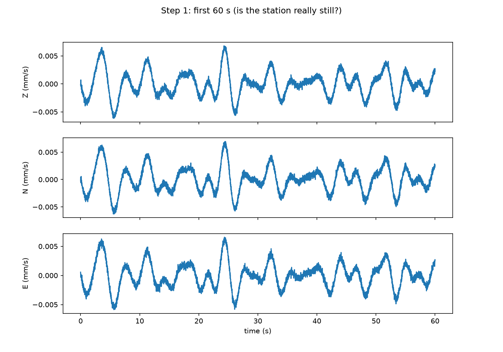
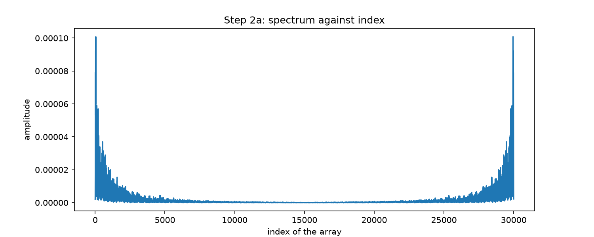
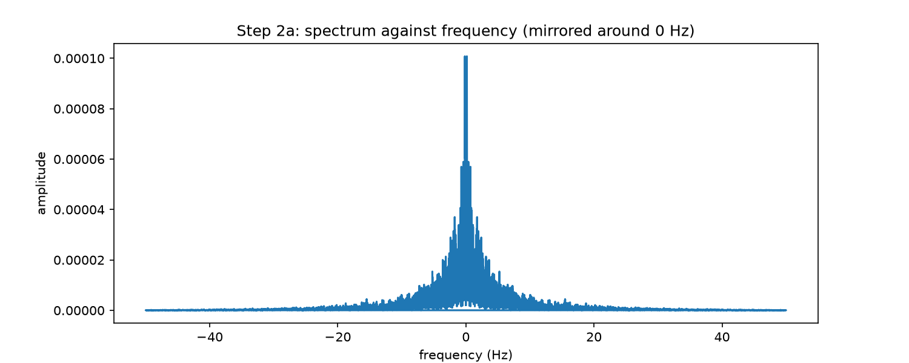
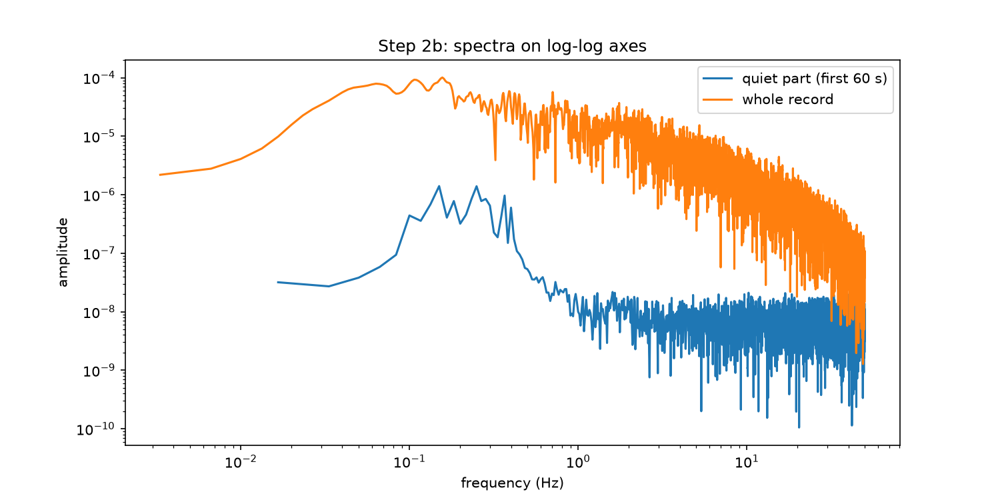
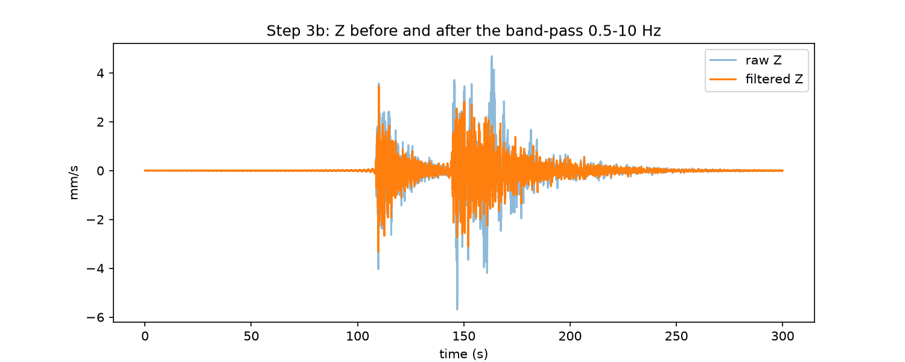
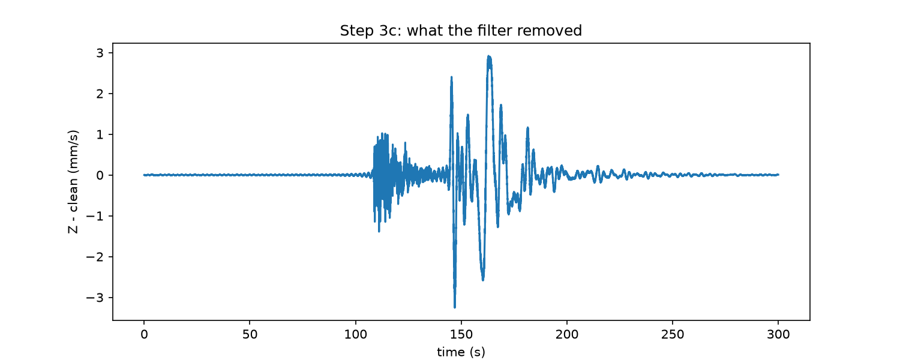
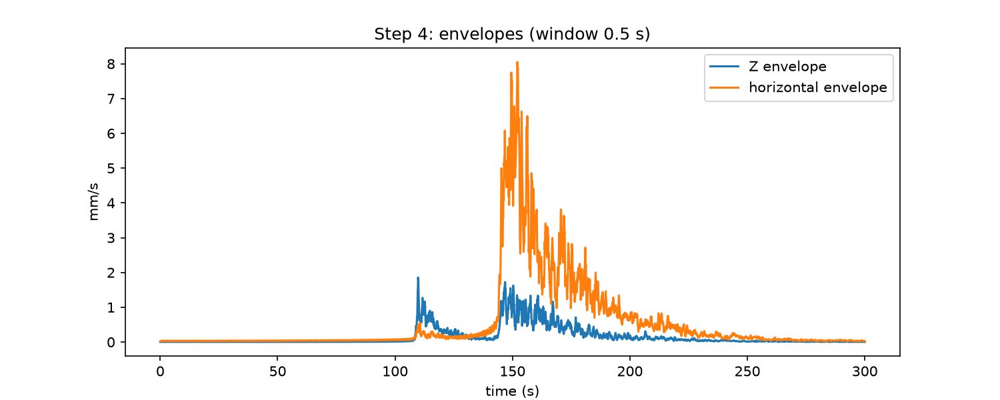
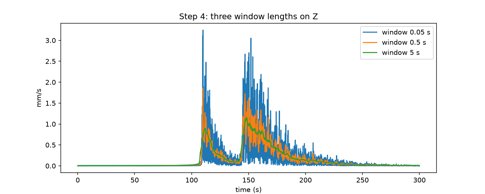
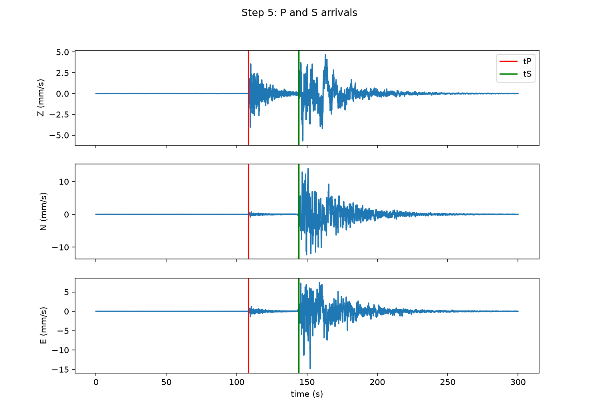
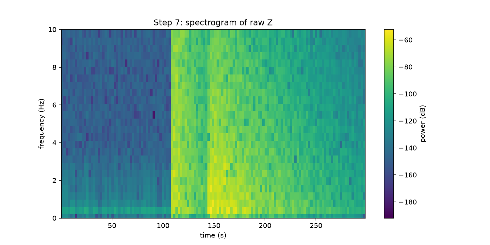

# CSPC - Computer Science for Physics and Chemistry

My coursework repository. Each practical is under PW<n>/Lab <X>/.

## Setup

Create the environment for a given lab:

    conda env create -f PW<1>/Lab\ <A>/environment.yml
    conda activate cspc

---

## PW1 - Lab A: Reproducible Foundations

**What I built:**
- A reproducible conda environment (`cspc`, Python 3.11 + numpy + pytest) and a
  Git repository tracking a radioactive-decay simulation with automated tests.

**Speed comparison (loop vs NumPy):**
- loop    : 3.2982 s
- numpy   : 0.0003 s
- speed-up: 9493.1 x faster

**Tests:** all passing? yes

**Conclusion:**
- NumPy was massively faster than the plain Python loop, which showed me why
  vectorising code matters. I also learned how Git branching and
  pushing to GitHub works, and why averaging over many runs is needed when
  dealing with randomness.


## PW1 --- Lab B

**Data:** The observed counts decrease over time, following an exponential decay shape.

**Comparison:**

**Pipeline:** The Snakemake rule rebuilds figure.png from the CSV and plot.py, and only reruns when one of them has changed.


## PW2 Lab A: Motion from Tracking Data

- **Measured Mean Acceleration:** -9.81 m/s²
- **Noise Explanation:** Differentiation amplifies measurement noise because it computes differences over small time intervals, making double-differentiation highly sensitive to small fluctuations.
- **Integration Findings:** Integrating noisy acceleration back to position suppresses noise via accumulation, matching the original trajectory within < 1 metre.


---

## PW2 --- Lab B: Optimization in Chemistry

**What I built:**
- `warmup.py`, which compares three optimisation methods (gradient descent, Newton's method and SLSQP) on an easy function and on a harder one.

### Part 2: Three routes to a minimum

**2A: easy function f(x) = (x-3)^2 + 1 (start x0 = 0):**
- gradient descent: x = 3.0
- Newton: x = 3.0
- SLSQP: x = 3.0
- All three methods reach the same minimum. The problem is so easy that it hides the differences between the methods.

**2B: harder function g(x) = x^4 - 3x^2 + x + 5:**

| Start | Gradient descent | Newton | SLSQP |
|---|---|---|---|
| x0 = 0 | -1.30 (minimum) | 0.17 (g'' = -5.65, maximum) | -1.30 (minimum) |
| x0 = 2 | 1.13 (minimum) | 1.13 (g'' = 9.35, minimum) | -1.30 (minimum) |

**Do the methods agree?**
- On the easy function, yes. On g(x), no: the answer depends on the method and on the starting point.

**Did Newton land on a minimum?**
- Not always. Starting from x0 = 0, Newton converged to x = 0.17, which is a maximum because g'' is negative there. Newton solves g'(x) = 0, which finds any stationary point (minimum, maximum or saddle), so the sign of g'' must be checked.

**How did the starting point change the result?**
- g(x) has two minima. The global minimum is at x = -1.30 (g = 1.49) and a local minimum is at x = 1.13 (g = 3.93).
- Starting from x0 = 2, gradient descent and Newton got trapped in the local minimum at x = 1.13. Starting from x0 = 0, gradient descent went to the global minimum, while Newton landed on the maximum.

**Lesson:**
- On a simple convex problem the methods agree easily. On a complicated landscape, the starting point and the algorithm both matter, and the type of stationary point must be checked.

### Part 3: Reaction rate fit

- Fitted rate constant k = 0.262 (the expected value is about 0.25). The fitted curve passes through the noisy measured points. The small difference from 0.25 comes from the noise in the data, including the noise in the first point used as C0.


### Part 4: Chemical equilibrium
- Newton and SLSQP agree: x = 0.667
- Equilibrium amounts: H2 = 0.333 mol, I2 = 0.333 mol, HI = 1.333 mol

### Part 5 (bonus): Titration

- The pH curve jumps and its slope peaks at about 50 mL, which is the equivalence point.

## PW3: Data, Distributions, Testing, and Causation

Scripts and plots are in `PW3/` (`pw3_heart.py`, `pw3_chemicals.py`). Run them from inside `PW3/`.

### Dataset 1: Heart disease (Cleveland)

**Source:** UCI Heart Disease dataset (Detrano et al., 1989), Cleveland subset, via Kaggle. 303 patients, `target` = 1 for heart disease (139) and 0 for healthy (164).

**Session 1: shape and normality** (`distributions.png`, `qqplots.png`)

| Variable | Shape | Shapiro p | Skew / ex. kurtosis | Verdict |
|---|---|---|---|---|
| age | one broad hump around 55-60, slightly left-skewed | 0.006 | -0.21 / -0.53 | approximately normal |
| chol | right-skewed with a long tail up to 564 | 6e-9 | 1.13 / 4.40 | not normal |
| trestbps | mildly right-skewed, tail up to 200 | 2e-6 | 0.70 / 0.85 | not normal (moderate) |
| thalach | mildly left-skewed, tail down to 71 | 7e-5 | -0.53 / -0.07 | roughly normal |

- With about 300 points, Shapiro-Wilk rejects even tiny deviations from normality, so I did not rely on the p-value alone. I also used Q-Q plots, skewness and kurtosis. `age` and `thalach` follow the Q-Q line closely, while `chol` and `trestbps` bend away at the tails.

**Session 2: is the effect real?**
- **Method:** I compared `thalach` between the two `target` groups with **Welch's t-test**, because the variances differ (Levene p = 0.023) and the disease group is normal while the healthy group is only mildly non-normal. With more than 100 patients per group the test is robust. I confirmed it with the non-parametric **Mann-Whitney U** test.
- **Result:** Welch t = -7.86, p = 9e-14. Mann-Whitney p = 2e-13. Cohen's d = -0.92 (large effect).
- **Conclusion:** The groups genuinely differ. Patients with heart disease reach a lower maximum heart rate, about 19 bpm lower.

**Uncertainty on the means** (`means_ci.png`)

| Group | Mean thalach | SEM | 95% CI |
|---|---|---|---|
| disease | 139.3 bpm | 1.92 | 135.5 to 143.0 |
| healthy | 158.4 bpm | 1.50 | 155.4 to 161.3 |

- The two confidence intervals do not overlap at all, so the plot agrees with the test.

**Age vs thalach** (`age_vs_thalach.png`)
- Pearson r = -0.39 (p = 1e-12), Spearman rho = -0.39, slope about -1 bpm per year. Older patients tend to have a lower maximum heart rate. The relationship is moderate with a lot of scatter, since age explains only about 15% of the variance.

**Bonus: how unpredictable is a category?**
- I used Shannon entropy, H = -sum(p log2 p).
- `target`: proportions 0.54 / 0.46, H = 0.995 bits out of a maximum of 1. It is almost perfectly balanced, so it is nearly as hard to guess as a coin flip.
- `sex`: proportions 0.68 / 0.32, H = 0.905 bits. It is more lopsided, so guessing "male" is right 68% of the time.

### Dataset 2: Chemical-exposure mystery

**Data note:** `chemicals cancer.csv` was not available on Moodle. I generated a synthetic stand-in with the same structure (1000 patients, benzene, cadmium, pollution index, age, malignancy score) using `make_standin_chemicals.py`. The numbers below come from that stand-in, not from the official file. The method is the same and can be re-run on the real file with `python pw3_chemicals.py`.

**Naive analysis (task 6)**
- Correlation with malignancy: benzene r = 0.72, cadmium r = 0.80.
- Taken at face value, **cadmium** looks like the cause because it is more strongly associated.

**Looking again (task 7)** (`confounding.png`)
- Suspected third variable: the pollution index. Cadmium correlates 0.96 with it, so cadmium may just be a stand-in for pollution.
- I restricted the data to patients with a similar pollution index (the 40th to 60th percentile, n = 199) and recomputed the correlations. I also computed partial correlations by removing the effect of pollution from both variables.

| | benzene | cadmium |
|---|---|---|
| Naive r | 0.72 | 0.80 |
| Restricted to similar pollution | 0.70 | 0.09 (p = 0.21) |
| Partial r (pollution removed) | 0.63 | 0.00 |

**Conclusion:** **Benzene is the real cause of malignancy.** Its association stays strong when pollution is held fixed. Cadmium only looked guilty: its association disappears once patients with the same pollution level are compared, because pollution drives both the cadmium level and the malignancy. This is a case where correlation is not causation.

# PW4 — Machine Learning: Supervised and Unsupervised

Reproduce everything with one command (from this folder):

```bash
snakemake --cores 1
```

Data: Yeh, I-C. (1998), *Concrete Compressive Strength*, UCI ML Repository. Forina et al., *Wine*, UCI ML Repository (loaded via scikit-learn).

---

# Session A — Concrete strength

## A1. Variables and units
| Variable | Meaning | Unit |
|---|---|---|
| cement | Portland cement | kg/m³ |
| slag | blast furnace slag | kg/m³ |
| ash | fly ash | kg/m³ |
| water | water | kg/m³ |
| superplastic | superplasticizer additive | kg/m³ |
| coarse_agg | coarse aggregate (gravel) | kg/m³ |
| fine_agg | fine aggregate (sand) | kg/m³ |
| age | age of the sample | days |
| strength (target) | compressive strength | MPa |

The dataset has 1030 laboratory tests (Yeh, 1998, UCI id 165). The new column names were assigned by position and checked against `concrete.variables`.

## A2. Cleaning
- Duplicate rows found: **25**, removed. Missing values: **0** in every column.
- Rows after cleaning: **1005**.
- Why a duplicate is a problem for a split: the same row can end up in both the training and the test set. The model has then already seen that test row, so the test score is too optimistic and does not measure generalisation.
- Inputs on much larger scales: coarse_agg (mean 974), fine_agg (773), water (182) and cement (279) are in the hundreds, while superplastic (mean 6, max 32) is tiny and age has a mean of 46 days. This is why scaling is needed later.
- Plots: 
- Strength vs cement: strength tends to increase with cement, but with a large scatter, so cement alone does not determine it. Strength vs age: strength rises quickly in the first weeks and then flattens, a curve and not a straight line. (Check this against your own figure.)

## A3. Split
Train: **804** rows, test: **201** rows (test_size=0.2, random_state=42).

## A4. Linear regression
Equation (strength in MPa; coefficients in MPa per kg/m³ for ingredients and MPa per day for age):

`strength = −23.389 + 0.1167·cement + 0.0981·slag + 0.0846·ash − 0.1314·water + 0.3315·superplastic + 0.0155·coarse_agg + 0.0206·fine_agg + 0.1106·age`

| train RMSE | test RMSE | test MAE | train R² | train adj R² | test R² |
|---|---|---|---|---|---|
| 10.002 | 11.191 | 8.895 | 0.610 | 0.606 | 0.580 |


Pattern in the residuals: the residuals are not randomly scattered around zero; they follow a curve against age (log axis). (Describe what you see in your own figure: where they are positive and where negative.) A systematic pattern means the model is missing a structure in the data. Here a straight line in age is the wrong shape, because strength grows roughly with log(age). It is an error of the model (bias), not noise, and a more flexible model or better features would remove it.

## A5. Polynomial regression
| degree | p | train RMSE | test RMSE | train R² | train adj R² | test R² |
|---|---|---|---|---|---|---|
| 1 | 8 | 10.002 | 11.191 | 0.610 | 0.606 | 0.580 |
| 2 | 44 | 6.989 | 8.308 | 0.809 | 0.798 | 0.769 |
| 3 | 164 | 4.396 | 5.952 | 0.925 | 0.905 | 0.881 |
| 4 | 494 | 2.334 | 39.410 | 0.979 | 0.945 | −4.206 |

- **Chosen degree: 3.** It has the lowest test RMSE (5.95 MPa) and the highest test R² (0.881). Degree 1 and 2 still underfit (high error on both sets). Degree 3 uses 164 features for 804 training rows, which is acceptable because the test error confirms it.
- **Degree 4:** it has p = 494 features for only n = 804 training rows. With almost as many parameters as rows, the model memorises the training data (train RMSE 2.33) and fails on new data: test RMSE 39.4 and test R² = −4.2, which is far worse than always predicting the mean strength.
- **Does adjusted R² alone protect?** No. At degree 4 the train adjusted R² is still 0.945 and looks excellent, although the model is useless on the test set. Adjusted R² only penalises the number of features on the training data, so the test set is needed to detect overfitting.

## A6. Classification (strength ≥ 40 MPa)
Class proportions: 0 (below 40 MPa): **0.642**, 1 (reaches 40 MPa): **0.358**. Split stratified on the class.

### KNN


| K | train acc | test acc |
|---|---|---|
| 1 | 0.998 | 0.831 |
| 3 | 0.934 | 0.801 |
| 5 | 0.907 | 0.816 |
| 7 | 0.893 | 0.836 |
| 15 | 0.848 | 0.826 |
| 25 | 0.841 | 0.806 |
| 51 | 0.805 | 0.781 |
| 101 | 0.757 | 0.736 |

- **Chosen K = 7.** It has the highest test accuracy (0.836). K = 1 memorises the training set (train 0.998) and is sensitive to noise, and a very large K (51, 101) underfits, because both accuracies drop. K = 7 is a compromise with a moderate train–test gap.
- **With vs without scaler** at K = 7: test accuracy **0.836 vs 0.821**. KNN uses raw distances, so without scaling the inputs with large numerical values (aggregates, water) dominate the distance.
- **Five splits** (random_state 0–4), test accuracies: 0.801, 0.851, 0.821, 0.836, 0.806. Mean 0.823, std 0.019, min–max spread 0.050.
- **Which differences are meaningful:** a spread of 0.05 between splits is larger than the scaler difference (0.015) and larger than the difference between K = 5, 7, 15 and 25 (about 0.03). So these differences are within the noise from the choice of split and cannot be considered meaningful. Only large differences (K = 101 at 0.736, or the tree of depth 1–2 at 0.70) are clearly real.

### Decision tree


| max_depth | leaves | train acc | test acc |
|---|---|---|---|
| 1 | 2 | 0.755 | 0.701 |
| 2 | 4 | 0.755 | 0.701 |
| 3 | 8 | 0.840 | 0.796 |
| 4 | 16 | 0.869 | 0.826 |
| 5 | 26 | 0.889 | 0.846 |
| 6 | 38 | 0.930 | 0.841 |
| 8 | 61 | 0.973 | 0.856 |
| None | 80 | 0.998 | 0.881 |

- **Gap between train and test:** it grows with depth, from about 0.05 at depth 1–4 to 0.09 at depth 6 and 0.117 for the unlimited tree (train 0.998). The deeper tree memorises the training data.
- **Chosen depth = 4** (16 leaves, test accuracy 0.826). The unlimited tree has the best test accuracy here (0.881), but it has 80 leaves, so it cannot be read or explained, and its gap is largest. With depth 4 I lose about 5 points of accuracy compared with the unlimited tree and gain a tree that a person can read, check against physics and explain to an engineer.
- Top two levels of the tree:
```
|--- age <= 42.00
|   |--- cement <= 257.70
|   |   |--- water <= 156.20
|   |   |--- water >  156.20
|   |--- cement >  257.70
|   |   |--- superplastic <= 0.95
|   |   |--- superplastic >  0.95
|--- age >  42.00
|   |--- superplastic <= 6.45
|   |   |--- fine_agg <= 749.55
|   |   |--- fine_agg >  749.55
|   |--- superplastic >  6.45
|   |   |--- cement <= 203.35
|   |   |--- cement >  203.35
```
- **Root question:** "Is the age ≤ 42 days?" Yes, it makes physical sense. Cement hydration is progressive, so young concrete has not yet developed its strength, and age is the strongest separator. Within young concrete the next questions are about cement (more cement, more strength) and water (less water, denser and stronger concrete), which is also what engineers expect.

## A7. Metrics
| model | TP | FP | FN | TN | accuracy | precision | recall | F1 |
|---|---|---|---|---|---|---|---|---|
| KNN (K=7) | 54 | 15 | 18 | 114 | 0.836 | 0.783 | 0.750 | 0.766 |
| Tree (depth=4) | 58 | 21 | 14 | 108 | 0.826 | 0.734 | 0.806 | 0.768 |

- **Dangerous mistake:** the **false positive** (FP): the model says the concrete reaches 40 MPa, but it does not. It could be used in a structure that is too weak. A false negative (FN) only wastes good concrete. The metric that controls FP is **precision** = TP / (TP + FP).

Threshold study (KNN, K = 7):

| threshold | TP | FP | FN | TN | precision | recall |
|---|---|---|---|---|---|---|
| 0.3 | 61 | 23 | 11 | 106 | 0.726 | 0.847 |
| 0.5 | 54 | 15 | 18 | 114 | 0.783 | 0.750 |
| 0.7 | 39 | 11 | 33 | 118 | 0.780 | 0.542 |
| 0.9 | 18 | 1 | 54 | 128 | 0.947 | 0.250 |

- **Chosen threshold: 0.9.** Because an FP is the dangerous mistake, I want the highest precision: at 0.9 only 1 of 19 concrete mixes announced as "≥ 40 MPa" is wrong (precision 0.947). With K = 7 the probabilities are multiples of 1/7, so 0.9 means that all 7 neighbours agree. Threshold 0.7 does not help (precision 0.780, the same as 0.5), so it only costs recall.
- **What a safer threshold costs:** recall falls from 0.750 to 0.250. The model finds only 18 of the 72 mixes that really reach 40 MPa and rejects 54 good ones (FN), so the concrete is wasted or must be tested again. Safety is paid for with cost and with missed good mixes.

The final metrics table is saved in `results/A_metrics.csv`.

## A8. Feature importance


| input | raw coef | std coef (MPa/std) | tree importance | permutation KNN | permutation tree |
|---|---|---|---|---|---|
| cement | 0.117 | 12.119 | 0.289 | 0.165 | 0.193 |
| slag | 0.098 | 8.437 | 0.020 | 0.055 | 0.000 |
| ash | 0.085 | 5.440 | 0.000 | 0.016 | 0.000 |
| water | −0.131 | −2.828 | 0.037 | 0.068 | 0.010 |
| superplastic | 0.331 | 1.971 | 0.193 | 0.066 | 0.171 |
| coarse_agg | 0.016 | 1.199 | 0.008 | 0.038 | 0.000 |
| fine_agg | 0.021 | 1.670 | 0.086 | 0.081 | 0.066 |
| age | 0.111 | 6.895 | 0.367 | 0.176 | 0.134 |

- **Raw vs standardised ranking:** by raw |coef| the order is superplastic, water, cement, age, slag, ash, fine_agg, coarse_agg. By standardised |coef| it is cement, slag, age, ash, water, superplastic, fine_agg, coarse_agg. They differ because the raw coefficients have different units and depend on the scale of each input. Superplastic is in a small numerical range (std 5.9 kg/m³), so its coefficient per kg is large (0.33), but one standard deviation changes the strength by only 2 MPa. Age has a small coefficient per day (0.11) but a large spread (std 64 days), so its effect per standard deviation is large (6.9 MPa). Only the standardised coefficients can be compared.
- **Do methods agree?** Yes on the top inputs: **cement and age** are in the top positions for the tree importances, for both permutation importances and for the standardised coefficients (where slag is also high). The tree also uses superplastic strongly (0.193), and KNN gives fine_agg some weight.
- **Consistent with water/cement ratio and age?** Age yes, it is among the top. Water has a negative coefficient as expected (more water, lower strength), but it ranks low alone (std coef −2.8, tree 0.037). Engineers talk about the *ratio* water/cement, not water alone, and the tree gets this information from cement and superplastic (a superplasticizer allows less water). So the ranking is partly consistent.
- **Does high importance mean that changing the ingredient changes the strength?** No (PW3). Importance measures what the model uses to predict, not a causal effect. The inputs are correlated (for instance superplastic and water are linked by the mix design), so importance can be shared or hidden between them, and an input can be important only because it is a proxy for another one. To know the effect of changing an ingredient, we would need a controlled experiment.

## Bonus — physics features
| model | features | test R² |
|---|---|---|
| linear, raw inputs (A4) | 8 | 0.580 |
| linear, log(age) | 8 | 0.804 |
| linear, log(age) + w/b | 8 | 0.806 |
| polynomial degree 2 (A5) | 44 | 0.769 |
| polynomial degree 3 (A5) | 164 | 0.881 |

Replacing age by log(age) raises the test R² from 0.58 to 0.80 with no extra features, which is better than the degree-2 polynomial with 44 features. The water/binder ratio adds almost nothing on top (0.806). Degree 3 is still better (0.881), but it needs 164 features and is hard to interpret. This suggests that domain knowledge (the right transformation) gives a large part of the gain at a very low complexity, and flexibility gives the rest at the cost of many parameters and the risk of overfitting.

---

# Session B — Wine chemistry

## B1. Data
The data is the UCI Wine dataset (Forina et al.), loaded with `load_wine`. It has 178 wines from the same region of Italy, from 3 cultivars (59, 71 and 48 wines). Each wine has 13 chemical measurements: alcohol, malic acid, ash, alkalinity of ash, magnesium, total phenols, flavanoids, nonflavanoid phenols, proanthocyanins, colour intensity, hue, OD280/OD315 of diluted wines and proline.

The measurements are on very different scales:
- Largest range and standard deviation: **proline** (278–1680, std 314.9), then **magnesium** (70–162, std 14.3), then alcalinity of ash (std 3.3).
- Smallest: **nonflavanoid phenols** (std 0.12), **hue** (std 0.23) and **ash** (std 0.27).

## B2. PCA on raw data
- Explained variance ratio of PC1: **0.9981** (99.8%).
- Sorted loadings of PC1: proline **0.9998**, magnesium 0.018, alcalinity of ash −0.005, all others below 0.003.
- PCA does not rescale, and proline has by far the largest variance (std 315 against at most 14 for any other measurement), so PC1 is almost just the proline axis. It reflects the units of the measurements, not the chemistry.
- I would not accept this PC1 as "the main chemical difference between the wines". The other 12 measurements are practically ignored.

## B3. PCA on scaled data


| PC | ratio | cumulative |
|---|---|---|
| 1 | 0.3620 | 0.3620 |
| 2 | 0.1921 | 0.5541 |
| 3 | 0.1112 | 0.6653 |
| 4 | 0.0707 | 0.7360 |
| 5 | 0.0656 | 0.8016 |
| 6 | 0.0494 | 0.8510 |
| 7 | 0.0424 | 0.8934 |
| 8 | 0.0268 | 0.9202 |
| 9 | 0.0222 | 0.9424 |
| 10 | 0.0193 | 0.9617 |
| 11 | 0.0174 | 0.9791 |
| 12 | 0.0130 | 0.9920 |
| 13 | 0.0080 | 1.0000 |

- Components needed for 90% of the variance: **8**. The PC1–PC2 plane keeps **55.4%**.
- Loadings, sorted:

| measurement | PC1 | measurement | PC2 |
|---|---|---|---|
| nonflavanoid_phenols | −0.299 | hue | −0.279 |
| malic_acid | −0.245 | od280/od315 | −0.164 |
| alcalinity_of_ash | −0.239 | alcalinity_of_ash | −0.011 |
| color_intensity | −0.089 | flavanoids | −0.003 |
| ash | −0.002 | nonflavanoid_phenols | 0.029 |
| magnesium | 0.142 | proanthocyanins | 0.039 |
| alcohol | 0.144 | total_phenols | 0.065 |
| proline | 0.287 | malic_acid | 0.225 |
| hue | 0.297 | magnesium | 0.300 |
| proanthocyanins | 0.313 | ash | 0.316 |
| od280/od315 | 0.376 | proline | 0.365 |
| total_phenols | 0.395 | alcohol | 0.484 |
| flavanoids | 0.423 | color_intensity | 0.530 |

- **PC1** pushes a wine to the positive side with many phenolic compounds (flavanoids, total phenols, proanthocyanins), a high OD280 value, high hue and high proline. It pushes to the negative side with nonflavanoid phenols, malic acid and alkalinity of ash. So PC1 is roughly "phenol-rich wines against acidic, low-phenol wines".
- **PC2** goes positive with colour intensity, alcohol, proline, ash and magnesium, and negative with hue and OD280. So PC2 is roughly "strong, dark, alcoholic wines against paler wines".
- Scatter in one colour : by eye I see **3 groups**.

## B4. K-Means
**(a)** Inertia for k = 3, n_init = 1:

| random_state | 0 | 1 | 2 | 3 | 4 | 5 | 6 | 7 |
|---|---|---|---|---|---|---|---|---|
| inertia | 1277.93 | 1278.76 | 1277.93 | 1277.93 | 1279.97 | 1278.76 | 1282.46 | 1278.76 |

The values differ because each run starts from different random centres, and K-Means only finds a local minimum of the inertia, which depends on the start. With `n_init=10` the algorithm runs 10 times from different starts and keeps the run with the lowest inertia, so the result is much less dependent on a lucky or unlucky start.

**(b)** Inertia for k = 1…10 (n_init = 10, random_state = 0): 

| k | 1 | 2 | 3 | 4 | 5 | 6 | 7 | 8 | 9 | 10 |
|---|---|---|---|---|---|---|---|---|---|---|
| inertia | 2314.0 | 1659.0 | 1277.9 | 1180.7 | 1110.4 | 1044.5 | 996.0 | 944.6 | 913.2 | 864.6 |

The curve drops steeply up to k = 3 (−655, then −381) and then flattens (−97 from k = 3 to 4, about −70 after). The elbow is at **k = 3**. Inertia can't be minimised directly because it always decreases when k grows. With k = 178 (one cluster per wine) it would be 0, which is useless.

## B5. Clusters (k = 3, scaled data)
Cluster sizes: **65, 51, 62**.

| measurement | cluster 0 | cluster 1 | cluster 2 |
|---|---|---|---|
| alcohol | 12.25 | 13.13 | 13.68 |
| malic_acid | 1.90 | 3.31 | 2.00 |
| ash | 2.23 | 2.42 | 2.47 |
| alcalinity_of_ash | 20.06 | 21.24 | 17.46 |
| magnesium | 92.74 | 98.67 | 107.97 |
| total_phenols | 2.25 | 1.68 | 2.85 |
| flavanoids | 2.05 | 0.82 | 3.00 |
| nonflavanoid_phenols | 0.36 | 0.45 | 0.29 |
| proanthocyanins | 1.62 | 1.15 | 1.92 |
| color_intensity | 2.97 | 7.23 | 5.45 |
| hue | 1.06 | 0.69 | 1.07 |
| od280/od315 | 2.80 | 1.70 | 3.16 |
| proline | 510.2 | 619.1 | 1100.2 |

- **Cluster 0 (65 wines):** light wines with the lowest alcohol (12.25) and proline (510) and a pale colour (colour intensity 2.97).
- **Cluster 1 (51 wines):** dark, acidic wines with the highest malic acid (3.31) and colour intensity (7.23), but the lowest flavanoids (0.82), hue and OD280.
- **Cluster 2 (62 wines):** rich wines with the highest alcohol (13.68), proline (1100) and flavanoids (3.00) and the lowest nonflavanoid phenols.


## B6. The reveal
Crosstab, scaled data (rows: true cultivar, columns: cluster):

| cultivar | cluster 0 | cluster 1 | cluster 2 |
|---|---|---|---|
| 0 | 0 | 0 | 59 |
| 1 | 65 | 3 | 3 |
| 2 | 0 | 48 | 0 |

| version | agreement |
|---|---|
| (i) scaled data | 0.966 |
| (ii) raw data | 0.702 |
| (iii) PC1–PC2 of scaled data | 0.966 |

- **(ii) raw is much worse** (0.702 against 0.966). As in B2, proline has by far the largest variance and dominates the Euclidean distances, so K-Means effectively clusters on proline (and magnesium) only and ignores the other measurements.
- **(i) scaled is best.** After scaling, every measurement has the same weight, so the clusters use the full chemistry.
- **(iii) PC1–PC2 equals (i)** (0.966), even though the two components keep only 55.4% of the variance (B3). The cultivar structure lies in the directions of largest variance of the scaled data, and the other components mostly add noise.
- K-Means never saw the cultivars, yet 172 of 178 wines are grouped with their own cultivar. So the three grape varieties have clearly different chemistry (mainly phenols, colour, alcohol and proline).

## Bonus — what do labels buy you?
| model | test accuracy |
|---|---|
| KNN scaled (13 features) | 0.933 |
| scaler + PCA(2) + KNN | 0.933 |

These supervised accuracies (0.933) are not better than the unsupervised agreement (0.966), but the comparison is not fair:
- the supervised models used the labels to learn, K-Means did not;
- the test set has only 45 wines (25%), so one wine changes the accuracy by about 2.2 points, while the agreement is computed on all 178 wines;
- the agreement score gives every cluster its majority cultivar, which is measured on the same data used for clustering, so it is a more favourable score than accuracy on unseen data.

---

# B7. Snakemake
Command reproducing all of PW4: `snakemake --cores 1`

1. `snakemake -n` plan: the dry run lists the jobs that would run (`fetch`, `session_a`, `session_b` and `all`), in the order fetch → session_a, with session_b independent, and it runs nothing. `session_a` comes after `fetch` because its input `data/concrete.csv` is the output of `fetch`.
2. After deleting `data/` and `results/` and running `snakemake --cores 1`: all four rules run (`fetch` creates `data/concrete.csv`, `session_a` and `session_b` create the two CSV files in `results/`, and `all` is done when both exist). Snakemake created the missing folders itself.
3. Running the same command again: Snakemake reports "Nothing to be done" (all files are up to date), because every output exists and is newer than its inputs, so no rule needs to run.
4. After changing K in `sessionA.py`: only `session_a` reruns (and `all` is just the final target), because `sessionA.py` is one of its inputs and is now newer than `results/A_metrics.csv`. `fetch` is not rerun because it has no inputs and its output `data/concrete.csv` still exists, and `session_b` is not rerun because it does not depend on `sessionA.py` or on the concrete data.


## PW5 - Signal Processing: Where Was the Earthquake, and How Strong?

### What I did

I analysed two seismograms (A and B) from a station with three channels: Z (vertical), N (north-south) and E (east-west), sampled at 100 Hz. Using only the recording, I found the P and S arrival times, the distance to the earthquake and its magnitude. At the end, I put everything in a Snakemake pipeline.

### How to run

```bash
conda activate cspc
cd PW5
python steps.py          # steps 1-8 on seismogram A, saves figures/
snakemake --cores 1      # steps 9-10: analyse.py -> report.py
```

### Step 1 - Look at the record




**What I see:** The record starts with small shaking, then a bigger shaking arrives, and later a long, slow shaking. The first weaker shaking (P-wave) is clearest on **Z** (vertical). The later, stronger shaking (S-wave) is largest on **N and E** (horizontal).

**Is the station still before the earthquake?** No. In the first 60 s the signal is small but never zero. This is the background noise of the Earth (mostly ocean waves) and of the instrument.

### Step 2 - The spectrum




**What does `fftfreq` add?** The FFT only gives numbers in an array. `fftfreq` tells which frequency in Hz belongs to each number, so the x-axis has a physical meaning.

**Why is the spectrum mirrored around 0 Hz?** The signal is real (it has no imaginary part). For a real signal, the value at -f is the complex conjugate of the value at +f, so the amplitudes are equal. This is why the amplitude is multiplied by 2 for the positive side, and divided by N so it does not depend on the record length.



**Background noise:** The quiet part is strongest at about **<fill from your plot, e.g. 0.1-0.3 Hz>**. This is the microseism, made by ocean waves hitting the coasts.

**Earthquake energy:** The earthquake adds most of its energy in the band about **<fill from your plot, e.g. 0.5-5 Hz>**.

### Step 3 - Inverse transform and manual band-pass filter

`np.allclose(np.fft.ifft(np.fft.fft(Z)).real, Z)` gives **True**.

**Why does filtering depend on this?** We delete frequencies in the frequency domain, and then we must come back to a time signal. This is only possible because the inverse FFT undoes the FFT exactly, so the only change comes from the frequencies we removed.

**Cut-offs:** I used **a = 0.5 Hz** and **b = 10 Hz**. The lower cut-off is above the microseism noise seen in the quiet spectrum, so the noise is removed. The upper cut-off is above the band where the earthquake has energy, so only high-frequency noise is removed.




**What is in "Z - clean":** I recognise **<the slow regular oscillation of the microseism and small fast noise; adapt to your plot>**. There is no clear earthquake shape, so the filter kept the earthquake.

### Step 4 - The envelope




**Window too short (0.05 s):** The envelope is jagged and still follows single waves, so it is hard to see one clear start of the shaking.

**Window too long (5 s):** The envelope is smeared. The shaking looks like it starts earlier and rises slowly, so the arrival times are not precise.

I used **0.5 s** as a compromise.

### Step 5 - Arrival times



- tP = first time the Z envelope is above 5 % of its maximum = **<tP> s**
- tS = first time after tP + 2 s that the horizontal envelope is above 10 % of its maximum = **<tS> s**
- Time of the horizontal maximum (`find_peaks`) = **<t_max> s**, which is **<t_max - tS> s** after tS.

**Why would the maximum give a wrong distance?** Both waves leave the source at the same moment, so the distance depends on when each wave **starts** to arrive. The maximum comes later than the start, and the delay is not the same for P and S. This would change tS - tP, and R would be wrong.

### Step 6 - Distance

```
tS - tP = R (1/vS - 1/vP)   =>   R = (tS - tP) / (1/vS - 1/vP)
```

with vP = 6.2 km/s and vS = 3.6 km/s. Here 1/vS - 1/vP = 0.1165 s/km.

**R = <R> km.**

**Effect of 1 s error in tS:** dR = 1 s / 0.1165 s/km = **8.6 km**.

**Origin time:** t0 = tP - R/vP = **<t0> s** after the start of the record.

### Step 7 - Spectrogram



- The **P-wave** arrives first, with the **highest frequencies**.
- The **S-wave** arrives next, with lower frequencies and more energy.
- The **surface waves** arrive last, with the **lowest frequencies**, and last a long time.

**What does the spectrogram show that the single spectrum cannot?** The single spectrum tells which frequencies exist in the whole record, but not when they happen. The spectrogram shows frequency and time together, so we can see which wave arrives when and with what frequencies.

### Step 8 - Magnitude

```
M = (log10(PGV) + log10(R) + 1.0) / 0.55
```

PGV = maximum of sqrt(N^2 + E^2) on the **raw** data, in cm/s (multiplied by 100 from m/s).

**PGV = <PGV> cm/s, M = <M>.**

**Why is log10(R) in the formula?** Waves get weaker with distance. A far earthquake gives a smaller ground motion than a close one of the same size. The term log10(R) corrects for this. If I ignored it, an earthquake recorded twice as far away would look smaller: M would be too low by log10(2) / 0.55 = **0.55 units**.

**PGV for one magnitude unit more at the same distance:** M increases by 1, so log10(PGV) increases by 0.55. PGV is multiplied by 10^0.55 = **about 3.5**.

### Step 9 - The whole system

`analyse.py` has one function `analyse(csv_file)` with steps 3-8. It runs on both records without any change between them and writes `results/events.csv`. `report.py` reads this table and writes `results/report.txt`.

| Earthquake | tP (s) | tS (s) | R (km) | PGV (cm/s) | M |
|---|---|---|---|---|---|
| A | | | | | |
| B | | | | | |

**Which earthquake was closer?** **<A or B>**, because it has the smaller R (smaller tS - tP).

**Which was stronger?** **<A or B>**, because it has the larger magnitude M.

### Step 10 - Snakemake

The `Snakefile` has three rules: `analyse` (both data files + `analyse.py` -> `results/events.csv`), `report` (`results/events.csv` + `report.py` -> `results/report.txt`) and `all`.

**(a)** After deleting `results/`, `snakemake --cores 1` ran both rules and created the results.

**(b)** Running it again: Snakemake says **"Nothing to be done"**. All outputs already exist and are newer than their inputs, so there is nothing to recompute.

**(c)** After changing only the wording in `report.py`: only the rule **`report`** reruns, because only its input script changed. `events.csv` is still up to date.

**(d)** After changing the cut-off `b` in `analyse.py`: **both `analyse` and `report`** rerun. `analyse` reruns because its script changed, and then `events.csv` is new, so `report` must run again because it depends on it.

**Why is the difference with (c) what we want from a pipeline?** A pipeline only recomputes what is affected by a change. A change in wording does not repeat the long analysis, but a change in the science updates everything that depends on it. This saves time and makes sure the final results are never out of date.
